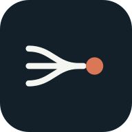

# selfhostr

**Self-hosted tools, minus the ceremony.**

We are two sysadmins, and we don't work for big corporations. 
When something bothers us, or we think we can do it better, we build it.

 

<table>
<tr>
<td align="center" width="96"></td>
<td><strong><a href="https://dumbmonit.selfhostr.io">DumbMonit</a></strong> Monitoring in one container: servers, network gear, hypervisors, storage and websites.</td>
<td align="center" nowrap><a href="https://dumbmonit.selfhostr.io">Website</a> · <a href="https://github.com/selfhostr/dumbmonit">Source</a></td>
</tr>
<tr>
<td align="center"></td>
<td><strong><a href="https://orch.selfhostr.io">orch</a></strong> A shared to-do list for teams. Tasks run on a teammate's machine and come back as pull requests.</td>
<td align="center" nowrap><a href="https://orch.selfhostr.io">Website</a> · <a href="https://github.com/selfhostr/orch">Source</a></td>
</tr>
<tr>
<td align="center"></td>
<td><strong><a href="https://suckerpot.selfhostr.io">suckerpot</a></strong> A honeypot with one readable dashboard and twelve realistic sensors. Meant to be attacked.</td>
<td align="center" nowrap><a href="https://suckerpot.selfhostr.io">Website</a> · <a href="https://github.com/selfhostr/suckerpot">Source</a></td>
</tr>
<tr>
<td align="center"></td>
<td><strong><a href="https://djsnake.selfhostr.io">djsnake</a></strong> A Discord music bot for your own server, with the video and the lyrics in sync on a web page.</td>
<td align="center" nowrap><a href="https://djsnake.selfhostr.io">Website</a> · <a href="https://github.com/selfhostr/djsnake">Source</a></td>
</tr>
<tr>
<td align="center"></td>
<td><strong><a href="https://kegtrack.selfhostr.io">kegtrack</a></strong> QR-code tracking for returnable beer kegs: every move in the cellar or at the customer is one scan.</td>
<td align="center" nowrap><a href="https://kegtrack.selfhostr.io">Website</a> · <a href="https://github.com/selfhostr/kegtrack">Source</a></td>
</tr>
</table>

 

Every project is open source under the MIT licence, and will stay open source and free. 
Every project runs on Docker and is built to stay simple. We are always honest about what a tool does and what it does not.

 

&nbsp;&nbsp;

<a href="https://github.com/laupernoe">laupernoe</a> · <a href="https://github.com/Theroxat">Theroxat</a>

